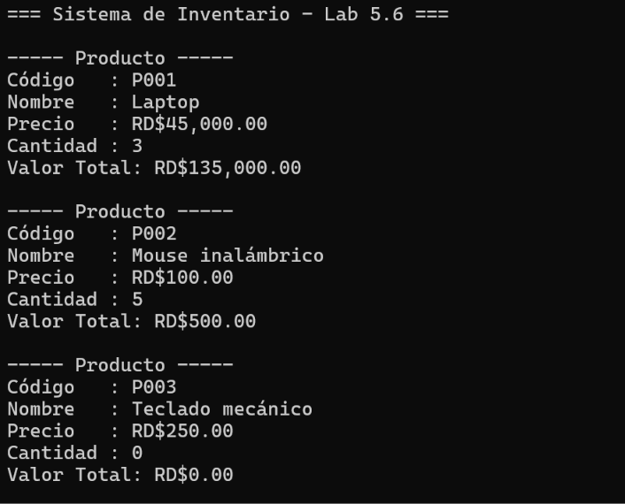
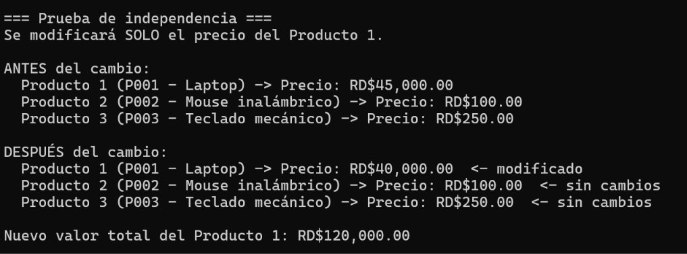

# Laboratorio 5.6 — Crear la clase Producto

**CodeArt Academy** · Programa FullStack .NET Cloud Developer
Módulo 1 — Fundamentos de Programación con C# · Semana 5, Día 1: Clases y Objetos

## Descripción

Primera etapa de un **sistema de inventario** para una empresa comercial. El proyecto implementa una clase `Producto` en C# que reúne la información básica de cada artículo (código, nombre, precio y cantidad), muestra sus datos y calcula el valor monetario de las unidades disponibles.

El programa crea tres objetos `Producto` independientes, les asigna valores, invoca sus métodos y demuestra que modificar un objeto no afecta a los demás.

## Objetivo

Diseñar e implementar una clase `Producto` en C# para almacenar características, mostrar información y calcular el valor total del inventario de cada producto (`Precio × Cantidad`).

## Estructura del proyecto

```
5.6-Lab_CrearLaClaseProducto/
├── docs/
│   └── evidencias/
│       ├── 01-productos-cp01-cp07.png
│       └── 02-independencia-cp05-cp08.png
├── 5-6_Lab_CrearLaClaseProducto.csproj
├── Producto.cs        # Clase Producto: propiedades y métodos
├── Program.cs         # Punto de entrada: crea y prueba tres objetos
└── README.md
```

## Modelo de la clase

```
Producto
+ Codigo: string
+ Nombre: string
+ Precio: decimal
+ Cantidad: int
+ MostrarInformacion(): void
+ CalcularValorTotal(): decimal
```

| Miembro | Descripción |
|---|---|
| `Codigo` | Identificador del producto (ej. `P001`). |
| `Nombre` | Nombre descriptivo del producto. |
| `Precio` | Precio unitario. Se usa `decimal` por tratarse de montos monetarios. |
| `Cantidad` | Unidades disponibles en inventario. |
| `MostrarInformacion()` | Imprime en consola las cuatro propiedades del producto. |
| `CalcularValorTotal()` | Devuelve `Precio × Cantidad`. |

## Requisitos

- [.NET SDK](https://dotnet.microsoft.com/download) 6.0 o superior
- Visual Studio 2022, Visual Studio Code o cualquier terminal

## Cómo ejecutar

```bash
git clone https://github.com/DHDanaurysHiraldo/5.6-Lab_CrearLaClaseProducto.git
cd 5.6-Lab_CrearLaClaseProducto
dotnet run
```

En Visual Studio: abrir el proyecto y presionar **F5** (o **Ctrl + F5** para ejecutar sin depurar).

## Casos de prueba

| ID | Escenario | Datos de prueba | Resultado esperado | Estado |
|---|---|---|---|---|
| CP-01 | Crear un objeto `Producto` | `new Producto()` | Instancia creada correctamente | ✅ |
| CP-02 | Asignar P001 y Laptop | Código `P001`, Nombre `Laptop` | Mostrar ambos valores | ✅ |
| CP-03 | Precio RD$100 y cantidad 5 | Producto 2 (P002) | Valor total RD$500.00 | ✅ |
| CP-04 | Precio RD$250 y cantidad 0 | Producto 3 (P003) | Valor total RD$0.00 | ✅ |
| CP-05 | Crear tres productos distintos | P001, P002, P003 | Cada objeto conserva sus datos | ✅ |
| CP-06 | Ejecutar `MostrarInformacion()` | Los tres productos | Mostrar las cuatro propiedades | ✅ |
| CP-07 | Ejecutar `CalcularValorTotal()` | Los tres productos | Devolver el cálculo correcto | ✅ |
| CP-08 | Modificar precio de un producto | Producto 1: RD$45,000 → RD$40,000 | No afectar los demás objetos | ✅ |

## Evidencias

### Ejecución completa: los tres productos (CP-01 a CP-04, CP-06, CP-07)



### Prueba de independencia de objetos (CP-05, CP-08)



## Matriz de trazabilidad

| Requerimientos | Casos de uso | Pruebas |
|---|---|---|
| RF-01, RF-06 | CU-01 Crear producto | CP-01 |
| RF-02 a RF-05, RF-07 | CU-02 Asignar información | CP-02, CP-05 |
| RF-08, RF-12 | CU-03 Consultar información | CP-06 |
| RF-09, RF-10 | CU-04 Calcular valor total | CP-03, CP-04, CP-07 |
| RF-11 | CU-01, CU-02 | CP-05, CP-08 |

## Conceptos aplicados

- **Clase y objeto:** `Producto` es el molde; cada `new Producto()` crea un objeto independiente en memoria.
- **Propiedades automáticas:** `{ get; set; }` para almacenar el estado de cada objeto.
- **Métodos de instancia:** operan sobre los datos del objeto que los invoca.
- **Separación de responsabilidades:** `CalcularValorTotal()` devuelve el valor en lugar de imprimirlo; `Program.cs` decide cómo presentarlo.
- **`decimal` para dinero:** evita los errores de redondeo de `double` en montos monetarios.

> **Alcance:** según el BRD, este laboratorio excluye constructores personalizados, encapsulamiento con validaciones, herencia y bases de datos. La protección del estado se implementará en el Día 2.

## Autor

**Danaurys Hiraldo**
GitHub: [@DHDanaurysHiraldo](https://github.com/DHDanaurysHiraldo)